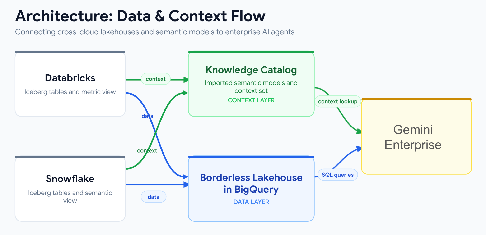

*Copyright 2026 Google LLC*

*Licensed under the Apache License, Version 2.0 (the "License");
you may not use this file except in compliance with the License.
You may obtain a copy of the License at*

*http://www.apache.org/licenses/LICENSE-2.0*

*Unless required by applicable law or agreed to in writing, software
distributed under the License is distributed on an "AS IS" BASIS,
WITHOUT WARRANTIES OR CONDITIONS OF ANY KIND, either express or implied.
See the License for the specific language governing permissions and
limitations under the License.*

<hr>

# Cross-cloud semantic context for agents with Knowledge Catalog

Teams often define their key business metrics in the tools they already use. In this solution, Finance defines revenue in a Snowflake semantic view, and Marketing defines loyalty tiers in a Databricks metric view. You import both semantic models into Knowledge Catalog and add a context set that links them to their Lakehouse tables and says how the two systems connect. Then you ask a Gemini Enterprise agent:

> What was our revenue by loyalty tier?

With this context, the agent uses Finance's definition of revenue and Marketing's loyalty tiers, and returns the figures that the business reports.



## What you build

- Sample Iceberg tables in Snowflake (orders and customers) and Databricks (loyalty members and app visits), queried from BigQuery through the Lakehouse.
- A Snowflake semantic view (`FINANCE_SALES`) and a Databricks metric view (`customer_engagement`).
- Knowledge Catalog connectors that import both semantic models.
- A Knowledge Catalog [context set](https://docs.cloud.google.com/knowledge-catalog/docs/context-sets) (Preview) with one document per semantic model, and one business rule that says `customer_id` identifies the same customer in both systems.
- A Gemini Enterprise app that queries the data through BigQuery and looks up the context through the [Knowledge Catalog integration](https://docs.cloud.google.com/gemini/enterprise/docs/connectors/connect-knowledge-catalog) (Preview).

## Prerequisites

- Snowflake and Databricks catalogs federated into BigQuery, as described in [Cross-cloud conversational analytics made simple with open standards](https://cloud.google.com/blog/products/data-analytics/cross-cloud-conversational-analytics-with-borderless-lakehouse). This solution adds new schemas (`SF_RETAIL_DB.SHOP` and `dbx_retail_db.shop`) to the catalogs from that setup.
- A Google Cloud project with Knowledge Catalog, and a Gemini Enterprise app. For the required APIs and roles, see the [Snowflake](https://docs.cloud.google.com/knowledge-catalog/docs/snowflake-horizon-transfer#before-you-begin) and [Databricks](https://docs.cloud.google.com/knowledge-catalog/docs/databricks-unity-transfer#before-you-begin) connector guides, [Manage context sets](https://docs.cloud.google.com/knowledge-catalog/docs/manage-context-sets) and, for Gemini Enterprise, [Connect to BigQuery](https://docs.cloud.google.com/gemini/enterprise/docs/connectors/connect-bigquery#bq-prereqs).
- The `gcloud` CLI and `curl`, for the context set script.

## Steps

Follow the [lab manual](lab-manuals/manual.md):

1. Create and load the sample tables in Snowflake and Databricks.
1. Create the Snowflake semantic view and the Databricks metric view.
1. Grant access to the Lakehouse and to the Knowledge Catalog connectors.
1. Import the semantic models with the Knowledge Catalog connectors.
1. Build the context set.
1. Ask Gemini Enterprise, without and with context.

## Expected result

With the semantic models and the context set in place, the agent reports net sales (completed orders only) by loyalty tier:

| Loyalty tier | Completed orders | Revenue (net sales, USD) |
| :--- | ---: | ---: |
| Gold | 402 | 103,288.18 |
| Bronze | 931 | 82,452.97 |
| Silver | 665 | 81,012.13 |
| Not a member | 552 | 35,947.12 |
| **Total** | **2,550** | **302,700.40** |

## What's in this folder

```text
cross-cloud-semantic-context/
├── README.md
├── images/                      architecture diagram and screenshots
├── lab-manuals/manual.md        step-by-step instructions
└── provisioning-automation/
    ├── snowflake/               01_setup, 02_load_data, 03_semantic_view, 04_grants
    ├── databricks/              01_setup, 02_load_data, 03_metric_view, 04_grants
    └── knowledge-catalog/       build_context_set.sh
```

## Clean up

See [Clean up](lab-manuals/manual.md#80-clean-up) in the lab manual.

## Disclaimer

This solution and its contents are not an official Google product. The code is intended for educational purposes. Review and harden it before you use it in your own environments.

## Author

Praveen Kumar, Customer Engineer, Data & AI, Google Cloud
