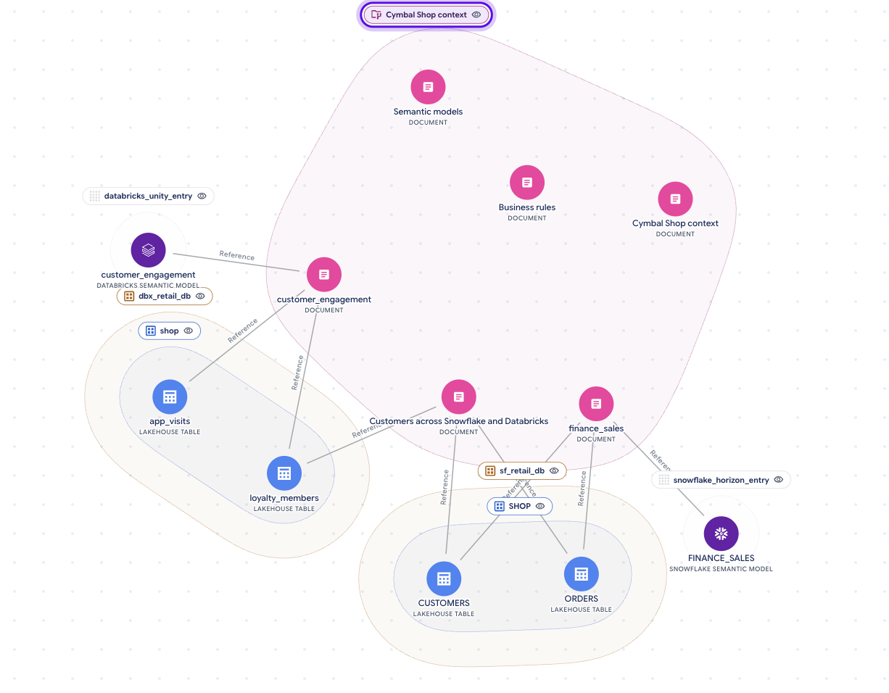
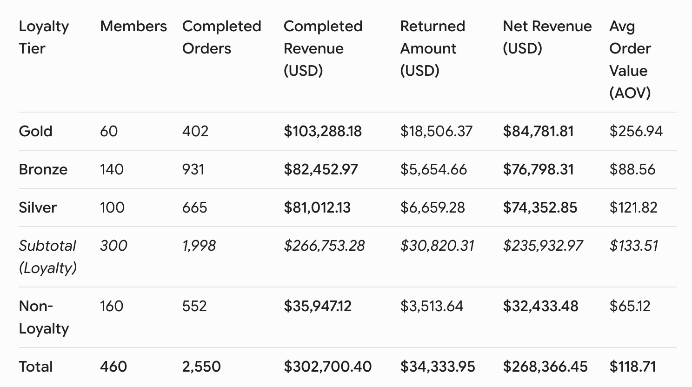
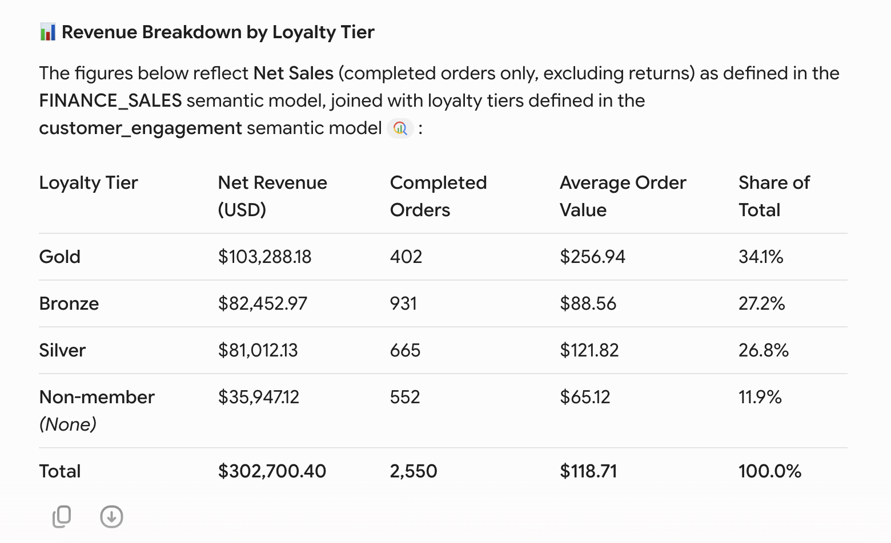

*Copyright 2026 Google LLC*

*Licensed under the Apache License, Version 2.0 (the "License");
you may not use this file except in compliance with the License.
You may obtain a copy of the License at*

*http://www.apache.org/licenses/LICENSE-2.0*

*Unless required by applicable law or agreed to in writing, software
distributed under the License is distributed on an "AS IS" BASIS,
WITHOUT WARRANTIES OR CONDITIONS OF ANY KIND, either express or implied.
See the License for the specific language governing permissions and
limitations under the License.*

<hr>

# Technical Solution: Cross-cloud semantic context for agents with Knowledge Catalog

## 1.0. About the lab

### 1.1. Abstract

This lab shows how to give an AI agent the business definitions that different teams keep in different platforms. Finance defines revenue in a Snowflake semantic view, and Marketing defines loyalty tiers in a Databricks metric view. You import both semantic models into Knowledge Catalog, link them to their Lakehouse tables in a context set, and add one business rule that connects the two systems. Then you ask a Gemini Enterprise agent the same question without and with that context.

|  |  |
| -- | :--- |
| Technical focus | Context engineering for cross-cloud data agents |
| Use case | Revenue by loyalty tier, with data in two platforms |
| Domain | Retail (Cymbal Shop, a fictional online store) |
| Dataset | Synthetic sample data: 500 customers, 2,751 orders, 300 loyalty members and 817 app visits |
| Products | Snowflake, Databricks, Lakehouse in BigQuery, Knowledge Catalog, Gemini Enterprise |

#### What to expect

Without the context, the agent can query the tables but has to decide on its own what "revenue" means. With the semantic models and the context set, it uses Finance's definition (net sales on completed orders) and Marketing's loyalty tiers.

### 1.2. Lab format

- Scripted SQL for Snowflake and Databricks, and a shell script for the context set
- Console steps for the Knowledge Catalog connectors and Gemini Enterprise
- Self-paced

### 1.3. Prerequisites

- Snowflake and Databricks catalogs federated into BigQuery, as described in [Cross-cloud conversational analytics made simple with open standards](https://cloud.google.com/blog/products/data-analytics/cross-cloud-conversational-analytics-with-borderless-lakehouse). This lab adds new schemas to the catalogs from that setup, and reuses its Lakehouse reader role in Snowflake and its federation service principal in Databricks.
- A Google Cloud project with Knowledge Catalog, and a Gemini Enterprise app. For the required APIs and roles, see the [Snowflake](https://docs.cloud.google.com/knowledge-catalog/docs/snowflake-horizon-transfer#before-you-begin) and [Databricks](https://docs.cloud.google.com/knowledge-catalog/docs/databricks-unity-transfer#before-you-begin) connector guides, [Manage context sets](https://docs.cloud.google.com/knowledge-catalog/docs/manage-context-sets) and [Connect to BigQuery](https://docs.cloud.google.com/gemini/enterprise/docs/connectors/connect-bigquery#bq-prereqs).
- The `gcloud` CLI and `curl`.
- The Snowflake scripts run as `ACCOUNTADMIN`, as in our test. Change the role if your account uses a different admin role.

### 1.4. Placeholders

Replace these values in the files before you run them:

| Placeholder | Replace with |
| :--- | :--- |
| `my-lakehouse-project` | Your Google Cloud project ID |
| `us-central1` | The location of your Lakehouse catalogs and Knowledge Catalog connectors. The context set script uses one location for all of them. |
| `s3://my-databricks-bucket/dbx_retail_db/shop/` | An external location for the Databricks schema |
| `<your_warehouse>` | The Snowflake warehouse for the connector |
| `myorg-myaccount` | Your Snowflake account identifier (organization name and account name) |
| `my_metastore` | Your Unity Catalog metastore name |
| `<lakehouse-sp-application-id>` | The application ID of the Databricks service principal for Lakehouse federation |
| `<connector-sp-application-id>` | The application ID of the Databricks service principal for the Knowledge Catalog connector |

<hr>

## 2.0. Create the sample data

### 2.1. Snowflake

In a Snowflake SQL worksheet, run these files in order:

1. `provisioning-automation/snowflake/01_setup.sql` creates the `SF_RETAIL_DB.SHOP` schema and the `CUSTOMERS` and `ORDERS` Iceberg tables.
1. `provisioning-automation/snowflake/02_load_data.sql` loads 500 customers and 2,751 orders.

### 2.2. Databricks

In the Databricks SQL editor, run these files in order:

1. `provisioning-automation/databricks/01_setup.sql` creates the `dbx_retail_db.shop` schema and the `loyalty_members` and `app_visits` Iceberg tables. Replace the S3 location first.
1. `provisioning-automation/databricks/02_load_data.sql` loads 300 loyalty members and 817 app visits.

Run each load script only once. Running it again adds the rows a second time.

<hr>

## 3.0. Create the semantic models

1. In Snowflake, run `provisioning-automation/snowflake/03_semantic_view.sql`. Finance's `net_sales` metric counts completed orders only, and lists "revenue" as a synonym.
1. In Databricks, run `provisioning-automation/databricks/03_metric_view.sql`. Marketing's `loyalty_tier` dimension comes from the loyalty members table. Customers who aren't members have no tier.

Each file ends with a quick check: `net_sales` is 302700.40 and `total_visits` is 817.

<hr>

## 4.0. Grant access

### 4.1. Lakehouse federation

Run section 1 of `provisioning-automation/snowflake/04_grants.sql` and `provisioning-automation/databricks/04_grants.sql`. They let the federation identities from the prerequisite setup read the new schemas.

The new tables then appear in BigQuery through the federated catalogs. To check, run this query in BigQuery:

```sql
SELECT
  (SELECT COUNT(*) FROM `my-lakehouse-project.sf_retail_db.SHOP.ORDERS`) AS orders,                 -- 2751
  (SELECT COUNT(*) FROM `my-lakehouse-project.sf_retail_db.SHOP.CUSTOMERS`) AS customers,           -- 500
  (SELECT COUNT(*) FROM `my-lakehouse-project.dbx_retail_db.shop.loyalty_members`) AS members,      -- 300
  (SELECT COUNT(*) FROM `my-lakehouse-project.dbx_retail_db.shop.app_visits`) AS app_visits;        -- 817
```

### 4.2. Knowledge Catalog connectors

- **In Google Cloud:** Enable the Dataplex API and the BigQuery Data Transfer Service API. Then grant the BigQuery Data Transfer Service service agent, `service-PROJECT_NUMBER@gcp-sa-bigquerydatatransfer.iam.gserviceaccount.com`, the Dataplex Entry Group Importer role and the Dataplex Entry and EntryLink Owner role on the project.
- **In Snowflake:** Run section 2 of `provisioning-automation/snowflake/04_grants.sql`. It creates a reader role and a service user that signs in with a key pair. The [Before you begin](https://docs.cloud.google.com/knowledge-catalog/docs/snowflake-horizon-transfer#before-you-begin) section of the Snowflake connector guide shows how to generate the key pair and assign it to the user.
- **In Databricks:** Create a service principal for the connector with an OAuth secret, and give it the Can use permission on your SQL warehouse. Then run section 2 of `provisioning-automation/databricks/04_grants.sql`. For the full list of permissions, see [Before you begin](https://docs.cloud.google.com/knowledge-catalog/docs/databricks-unity-transfer#before-you-begin) in the Databricks connector guide.

<hr>

## 5.0. Import the semantic models

Knowledge Catalog's built-in connectors import Snowflake semantic views and Databricks metric views. Each connector runs as a BigQuery Data Transfer Service job and writes the metadata to a Knowledge Catalog entry group.

1. In the Google Cloud console, go to **Knowledge Catalog**. In the **Manage** section, click **Connectors**, click **Add connection**, and select **Snowflake Horizon**.
1. Enter the connection details, browse to the database, and create a new entry group named `snowflake_horizon`.
1. Choose a schedule, or run the job on demand.
1. Repeat the steps with the **Databricks Unity Catalog** card and an entry group named `databricks_unity`.

Each run imports the semantic models with their formulas, descriptions, synonyms and relationships, and links them to their source tables. Snowflake's `ACCOUNT_USAGE` views can lag, so a new semantic view might not appear in the first run.

Before you continue, wait until both runs have finished and both semantic models, `FINANCE_SALES` and `customer_engagement`, appear in Knowledge Catalog. The context set script in the next step links to them.

<hr>

## 6.0. Build the context set

A [context set](https://docs.cloud.google.com/knowledge-catalog/docs/context-sets) is a Knowledge Catalog entry group that holds the context an agent should use for a domain.

1. Open `provisioning-automation/knowledge-catalog/build_context_set.sh` and set the variables at the top: `PROJECT`, `LOC`, `CS`, `DBX_GROUP`, `DBX_METASTORE`, `SF_GROUP` and `SF_ACCOUNT`. To find `SF_ACCOUNT` and `DBX_METASTORE`, open each imported semantic model in Knowledge Catalog and copy its resource name. The value after `/entries/` is the one to use, for example `.../entries/myorg-myaccount/catalogs/SF_RETAIL_DB/...`.
1. Run the script:

   ```bash
   bash provisioning-automation/knowledge-catalog/build_context_set.sh
   ```

   The script stops at the first error. If it stops partway, or if the context set already exists from an earlier run, delete the context set first or choose another `CS` value.

The script creates the context set `cymbal_context` with 6 entries and 9 links:

```text
cymbal_context                        context set (entry group)
└── agents                            root, "Cymbal Shop context"
    ├── semantic-models               "Semantic models"
    │   ├── customer_engagement
    │   │     ce-model     → databricks_unity/dbx_retail_db.shop.customer_engagement
    │   │     ce-visits    → @biglake/dbx_retail_db.shop.app_visits
    │   │     ce-members   → @biglake/dbx_retail_db.shop.loyalty_members
    │   └── finance_sales
    │         fs-model     → snowflake_horizon/SF_RETAIL_DB.SHOP.FINANCE_SALES
    │         fs-orders    → @biglake/sf_retail_db.SHOP.ORDERS
    │         fs-customers → @biglake/sf_retail_db.SHOP.CUSTOMERS
    └── documents                     "Business rules"
        └── customers-across-systems  "Customers across Snowflake and Databricks"
              xs-orders    → @biglake/sf_retail_db.SHOP.ORDERS
              xs-customers → @biglake/sf_retail_db.SHOP.CUSTOMERS
              xs-members   → @biglake/dbx_retail_db.shop.loyalty_members
```

All links are `reference` links. The part before `/` is the target's entry group: `@biglake` for the Lakehouse tables, and the connectors' entry groups for the two semantic models. To see the context set, open **Knowledge Studio** (Preview) and select **Context sets**.



<hr>

## 7.0. Ask Gemini Enterprise

1. Connect your Gemini Enterprise app to BigQuery in federated query mode. This turns on the Knowledge Catalog integration automatically. See [Connect to BigQuery](https://docs.cloud.google.com/gemini/enterprise/docs/connectors/connect-bigquery).
1. Add one sentence to the assistant instructions. In your Gemini Enterprise app, click **Configurations**, select the **Assistant** tab, select **Customize** under **Additional LLM system instructions**, enter the following sentence, and click **Save and publish**. See [Configure the assistant](https://docs.cloud.google.com/gemini/enterprise/docs/configure-assistant).

   *Before writing SQL, look up the source semantic model's own catalog entry (Snowflake or Databricks), not just the summary attached to the context set, and use its relationships and metric definitions.*

### 7.1. Without context

On the same **Assistant** tab, turn off **Enable Knowledge Catalog**. Ask **"What was our revenue by loyalty tier?"** The agent can still query the tables, but it has to decide on its own what revenue means. In our test, it reported a second "net revenue" figure that subtracted returned orders again.



### 7.2. With context

Turn **Enable Knowledge Catalog** back on, and ask the same question. The agent should report one revenue figure per tier and name its sources: the `NET_SALES` metric in the Snowflake semantic view, the loyalty tier in the Databricks metric view, and `customer_id` as the key between the two systems.

| Loyalty tier | Completed orders | Revenue (net sales, USD) |
| :--- | ---: | ---: |
| Gold | 402 | 103,288.18 |
| Bronze | 931 | 82,452.97 |
| Silver | 665 | 81,012.13 |
| Not a member | 552 | 35,947.12 |
| **Total** | **2,550** | **302,700.40** |



<hr>

## 8.0. Clean up

1. In Knowledge Catalog, delete the two connector transfer configurations first, so that a scheduled run doesn't import the models again. Then delete the `cymbal_context` context set and the `snowflake_horizon` and `databricks_unity` entry groups.
1. In Gemini Enterprise, remove the assistant instruction if you no longer need it.
1. Drop the sample objects:

   ```sql
   -- Snowflake
   DROP SEMANTIC VIEW IF EXISTS SF_RETAIL_DB.SHOP.FINANCE_SALES;
   DROP SCHEMA IF EXISTS SF_RETAIL_DB.SHOP;

   -- Databricks
   DROP VIEW IF EXISTS dbx_retail_db.shop.customer_engagement;
   DROP SCHEMA IF EXISTS dbx_retail_db.shop CASCADE;
   ```

1. If you created them only for this lab, also remove the connector users, service principals and roles from section 2 of the grants files.
